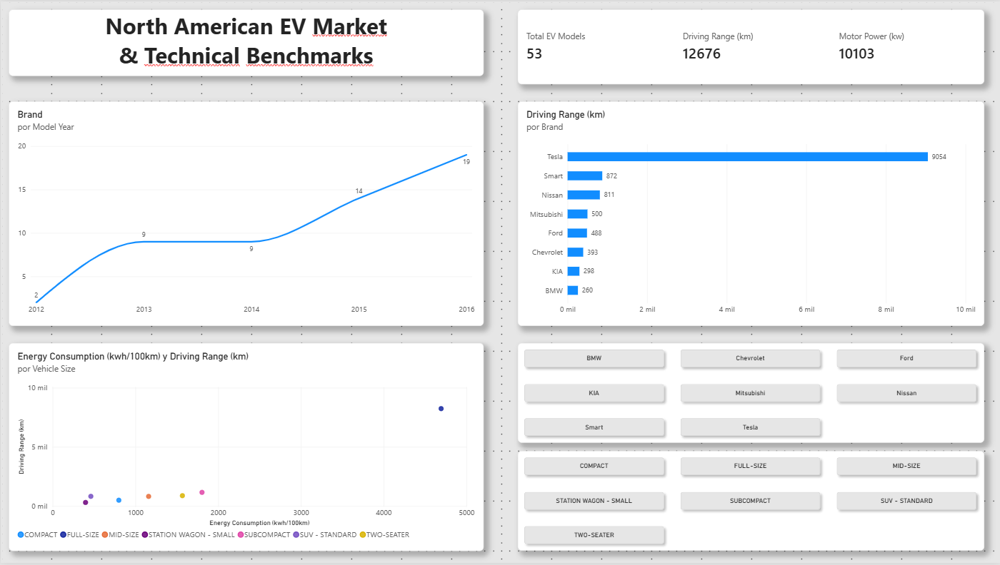

# North American Electric Vehicle (EV) Market & Catalog QA Analysis

## Project Overview
As the automotive industry transitions toward electrification, manufacturers and digital platforms need accurate technical specifications and clear market benchmarks. Drawing on my prior experience managing vehicle catalog data for the North American market, I performed a **Data Quality Assurance (QA) audit** and exploratory market analysis on an Electric Vehicle specification dataset.

**Tools & Technologies Used:**
* **Python (Pandas):** Data quality auditing, text standardization, `snake_case` schema normalization, and feature engineering (`km_charged_per_hour`).
* **SQL (SQLite):** Market evolution analysis, brand benchmarking, Common Table Expressions (`CTEs`), and Window Functions (`RANK()`).
* **Power BI:** Interactive executive dashboard for comparing driving range, motor power, and energy consumption across brands and vehicle sizes.

---

## Data QA & Engineering Highlights
1. **Schema Standardization:** Normalized raw column headers containing special characters and units (e.g., `CITY (kWh/100 km)`, `(kW)`) into clean, database-ready `snake_case` identifiers.
2. **Text & Brand Consistency:** Audited categorical attributes (`brand`, `model`, `vehicle_size`) to remove trailing whitespace and standardize brand capitalization while preserving acronyms (`BMW`, `GMC`, `KIA`).
3. **Feature Engineering:** Created a charging efficiency metric (`km_charged_per_hour`) to evaluate how many kilometers of range each vehicle recovers per hour of charging.

---

## Key Analytical Insights
1. **Steady Range Expansion:** Average driving range (`range_km`) shows a consistent upward trend across model years as battery technology matured.
2. **Efficiency vs. Vehicle Size:** Smaller vehicle segments achieve significantly lower energy consumption (`comb_kwh_100km`), whereas larger SUVs and performance models trade energy efficiency for higher motor power (`motor_power_kw`).
3. **Brand Benchmarking:** Using SQL Window Functions (`RANK()`), top-performing models were isolated within each vehicle size category to benchmark competitors (including Ford's EV lineup) against market leaders.

---

## Dashboard Preview


---

## Repository Structure
```text
├── data/
│   ├── raw/                 # Original North American EV dataset
│   └── processed/           # Standardized dataset & SQLite database
├── notebooks/
│   ├── 01_catalog_qa_audit.ipynb   # QA audit, normalization & feature engineering
│   └── 02_ev_sql_analysis.ipynb    # SQLite analysis using CTEs & Window Functions
├── sql/
│   └── ev_market_queries.sql       # Standalone SQL queries
├── powerbi/
│   ├── images/                     # Dashboard screenshots
│   └── ev_market_dashboard.pbix    # Power BI interactive report
└── README.md
```

---

## Author
**Jonathan Ezequiel Ilardi**  
* [LinkedIn](https://www.linkedin.com/in/jonilardi/)
